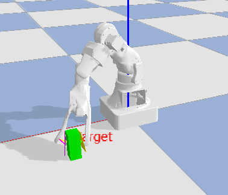

# 🧨 **[](https://git.io/typing-svg)**

**• Система дообучения которая не будет ломать прошлые веса и конфиг — 12.04**  


**• Дообучить брать кубик не сдвигая его и не сбивая — 13.04**  


**• Дообучить брать кубик в рандонмных местах — 15.04**  
---


**• Добить полный стартовый функцыонал на агенте — 20.04**  


     
## Чудище уже берет кубик ✨😎✨

# FRIDAY_Mini — Архитектура Пятницы

> Добро пожаловать в проект **FRIDAY_SIM** — билет на порше с милфой 🤖

---

## 🧬 Клонировать репозиторий

Если хочешь склонировать проект напрямую через git:

```bash
git clone https://github.com/Sulimowski/Friday_Mini.git
```

---

# 📥 **[](https://git.io/typing-svg)**


[](https://github.com/Sulimowski/Friday_Mini/archive/refs/heads/master.zip)

---


**Made with ❤️ by Sulimowski**


