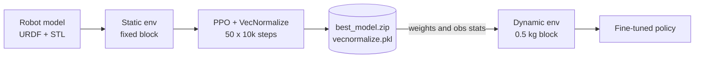
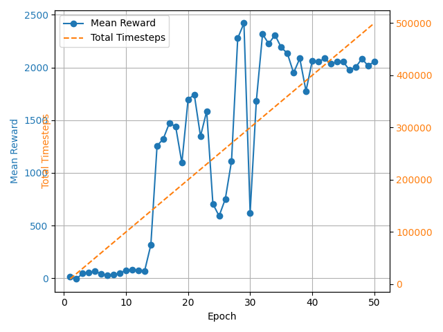

# FRIDAY Mini

Reinforcement learning for grasping with my own 6-joint robot arm in PyBullet. A PPO agent is trained from scratch on a fixed block, then fine-tuned on a block that moves when pushed.


## Overview

- The robot is my own model (URDF + STL meshes) with 6 revolute joints, the last one drives the gripper.
- A grasp only counts when both gripper pads touch opposite sides of the block, so the agent cannot just bump into it.
- The reward combines distance, contact, gripper orientation, a penalty for getting stuck and, in the second stage, a penalty for pushing the block.
- Static training: 50 epochs of 10k steps (500k steps). Mean evaluation reward goes from about 0 to about 2,000.
- The best static policy and its observation normalization stats are reused to fine-tune on a movable 0.5 kg block.
- Every epoch is checkpointed; the best model is saved together with its `VecNormalize` stats.



## Environments

| | Static (`grasp_env.py`) | Dynamic (`grasp_env_dynamic.py`) |
| --- | --- | --- |
| Block | fixed, with a contact pad on each side | 0.5 kg, moves when pushed |
| Action | change of each joint angle, up to ±0.2 rad per step | same |
| Control | position control, 5 physics substeps at 240 Hz (about 48 Hz per action) | same |
| Observation (21 values) | joint angles, gripper position, block position, vector to the block, vectors to both pads | same layout, pad vectors are zeros, so the static policy loads without changes |
| Episode end | success, stuck for 30+ steps, or 500 steps | success, block pushed more than 8 cm, or 500 steps |

## Reward

Static env:

| Term | Value |
| --- | --- |
| Step penalty | −0.01 |
| Approach, for each pad | +5 · exp(−50 · d) |
| Both pads in contact | +25, up to +3 more when the gripper points down |
| Contact with a tilted gripper (alignment < 0.5) | −5 · (1 − alignment) |
| Only one pad in contact | −2 |
| Success: both pads within 2.5 cm, alignment > 0.8 | +50, episode ends |
| Stuck for more than 30 steps | −5, episode ends |

Dynamic env:

| Term | Value |
| --- | --- |
| Approach | +1 · exp(−50 · d) |
| Contact | +1.5, +2.5 more within 3 cm |
| Success: contact within 2 cm, block moved less than 1.5 cm | +15, episode ends |
| Block moved more than 1.5 cm | up to −2, smooth (tanh) |
| Block pushed more than 8 cm | −3 and reset |

## Results



Mean reward of 5 deterministic evaluation episodes after each epoch. Learning takes off after about 150k steps, peaks near 2,400 and stays around 2,000 for the last 10 epochs.

## Training settings

| Parameter | Value |
| --- | --- |
| Algorithm | PPO, `MlpPolicy` |
| `n_steps` / `batch_size` / `n_epochs` | 4096 / 256 / 15 |
| `learning_rate` / `clip_range` | 2e-4 / 0.15 |
| `gamma` / `gae_lambda` / `ent_coef` | 0.99 / 0.95 / 0.01 |
| Normalization | `VecNormalize` on observations |
| Evaluation | 5 episodes after every 10k steps |
| Early stopping | patience 30 epochs, plus a plateau check |

## Repository structure

```text
.
├── grasp_env.py               # static environment
├── grasp_env_dynamic.py       # dynamic environment
├── train.py                   # PPO training, static
├── train_dynamic.py           # transfer and fine-tuning, dynamic
├── test.py                    # replay of the static policy in the PyBullet GUI
├── test_dynamic.py            # replay of the fine-tuned policy
├── pretty_mukoco/             # robot URDF / MJCF and STL meshes
├── models/                    # checkpoints, best model, VecNormalize stats
└── logs/                      # reward logs and training curves
```

## Running

```bash
git clone https://github.com/Sulimowski/Friday_Mini.git
cd Friday_Mini
pip install pybullet gymnasium stable-baselines3 numpy pandas matplotlib
```

The environments load the robot from an absolute path. Change `loadURDF(...)` in `grasp_env.py` and `grasp_env_dynamic.py` to `pretty_mukoco/FRIDAY_MINI.urdf` before running.

```bash
python test.py            # watch the trained policy, weights are in models/
python train.py           # train from scratch
python train_dynamic.py   # fine-tune on the movable block
python test_dynamic.py    # watch the fine-tuned policy
```

## Next steps

- Random block position and size (now it is always at x = 0.3, y = 0.2)
- Report grasp success rate, not only mean reward
- Relative paths to assets and a `requirements.txt`
- Move to MuJoCo with a hierarchical agent: a high-level policy picks the skill, PPO / SAC primitives execute it

## Author

Mykhailo Sulimovskyi · [LinkedIn](https://linkedin.com/in/misha-sulimovskiy-9809572b3) · [Sim2Real, dual-arm UR5 project](https://github.com/Sulimowski/Sim2Real) · 2005.sulimovsky@gmail.com
