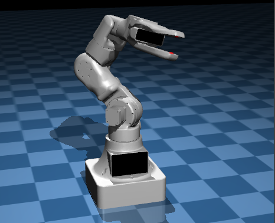

# Правильно настроенная симуляция как у людей
## Первый код работает быстрее но физика не до конца настроена
## Второй код медлинее но физика настроена<3 

---

### 🧨 **[](https://git.io/typing-svg)**

**• Кинематика в Mujoco — 10.04**  


**• 3D-карта реальных объектов — 10.04**  


**• Построить мини версию — 15.04**  


<table>
  <tr>
    <td><strong>• Построить сына и высрать дом — !@#12</strong></td>
    <td>
      
    </td>
  </tr>
</table>


    

---

## 🧬 Клонировать репозиторий

Если хочешь склонировать проект напрямую через git:

```bash
git clone https://github.com/Sulimowski/Friday_Mini.git
```

---

# 📥 **[](https://git.io/typing-svg)**


[](https://github.com/Sulimowski/Friday_Mini/archive/refs/heads/master.zip)


---

**Made with ❤️ by Sulimowski**
